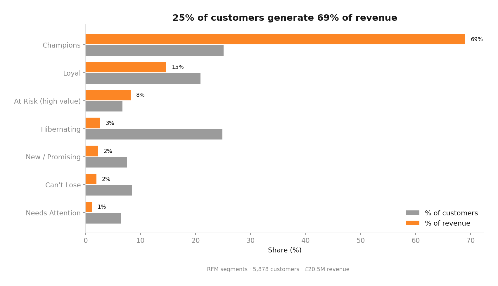
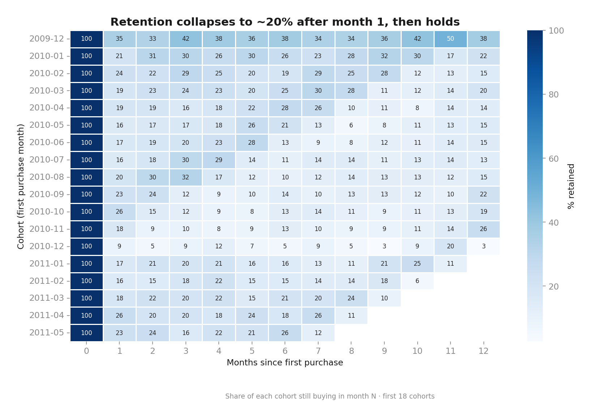

# Customer RFM & Retention Analysis

**1,007,913 real transactions from a UK online retailer — 5,878 customers, £20.5M of revenue, and a retention curve that flatlines at 20% after the first month.**

SQL (SQLite star schema, 10 queries) · Python (pandas, matplotlib, seaborn) · Excel (live formulas) · no machine learning.



## Findings

| # | Finding | Number |
|---|---|---|
| 1 | **A quarter of customers carry 69% of revenue.** 1,473 Champions average 15.7 orders and £8,135 lifetime value. | 25.1% → 69.0% |
| 2 | **725 customers (£1.9M) have gone quiet.** "At Risk (high value)" alone is 395 customers and £1.43M of dormant revenue. | £1.9M at stake |
| 3 | **One customer is 15.1% of the business.** The top 100 accounts are 46.9% of revenue. | 100 → 46.9% |
| 4 | **Order value is bimodal.** 9% of orders are £1k+ and produce 45.9% of revenue; 14.5% of orders are under £100 and produce 1.2%. | £9.4M from 3,599 orders |
| 5 | **Retention collapses then holds.** Median month-1 retention is 20.5%, and cohorts do not decay much further after that — the leak is in month 1, not year 2. | 20.5% |
| 6 | **72.4% of customers reorder**, but 40.8% have not bought in 180+ days. | 4,238 vs 2,399 |



## The decision this supports

The win-back pool (At Risk + Hibernating + Can't Lose) is 2,351 customers holding £2.24M of historical revenue. Reactivating 10% of that pool at their historical average order value is worth roughly £224k — larger than the gain from acquiring ~440 new customers at the current average lifetime value.

## Data

**UCI Online Retail II** — a real UK-based online retailer, 01/12/2009 to 09/12/2011, 1,067,371 invoice lines across two workbook sheets.

Cleaning is explicit and counted in [`data/clean/data_quality.json`](data/clean/data_quality.json):

| Exclusion | Rows | Why |
|---|---|---|
| Cancelled invoices (`C…`) | 19,494 | Reversals, not purchases |
| Non-positive quantity | 3,457 | Damaged/lost adjustments |
| Non-positive price | 2,750 | Free items, errors |
| Exact duplicate rows | 33,757 | Repeated lines in the extract |
| No Customer ID | 228,488 | Guest checkouts — **15.2% of revenue**, kept in revenue totals but out of any RFM model |

**Nothing is imputed.** A guest sale cannot be assigned to a customer, so it is reported separately rather than dropped silently.

## Method

- **RFM**: recency measured against a snapshot of 2011-12-10; frequency = distinct invoices; monetary = sum of line totals. Each dimension scored 1–5 by quintile, with rank-then-`qcut` so ties never break the binning.
- **Segments** are explicit rules, not a model: Champions (R≥4 & F≥4), Loyal (R≥3 & F≥3), At Risk (R≤2 & M≥4), Can't Lose, Needs Attention, New/Promising, Hibernating.
- **Cohorts**: first purchase month defines the cohort; retention in month *n* is the share of that cohort with at least one invoice in month *n*.

## Queries (10)

| Technique | Queries |
|---|---|
| `NTILE`/quintile ranking for RFM | (RFM built in pandas; SQL serves the aggregates) |
| Cohort matrix with self-join + window sizes | q04 |
| `LAG` for month-over-month growth | q06 |
| Running total for customer Pareto | q03 |
| Conditional aggregation (revenue at risk) | q09, q10 |
| `HAVING` thresholds for market tables | q08 |

## Excel deliverable

`output/Customer_RFM_Summary.xlsx` — customer-level sheet (5,878 rows) with a Summary sheet where every figure is a live `COUNTIF`/`SUMIF`/`AVERAGEIF` formula, plus a native Excel chart. Recalculated in Excel, then **diffed against pandas: 7/7 metrics match**.

## Reproduce

```bash
git clone https://github.com/hrishitprakash2-debug/customer-rfm-analysis.git
cd customer-rfm-analysis
pip install -r requirements.txt
# data: see data/README.md (45 MB workbook, not committed)
python scripts/01_convert.py
python scripts/02_clean_rfm.py
python scripts/03_build_db.py
python scripts/04_run_queries.py
python scripts/05_charts.py
python scripts/06_build_excel.py
python scripts/07_recalc_excel.py   # Windows + Excel only
```

## Limitations

- The retailer is **wholesale-heavy**, so lifetime values are far above consumer benchmarks — the *structure* (concentration, month-1 leak) transfers better than the absolute amounts.
- No marketing, channel or margin data, so the win-back value is **revenue**, not profit, and no campaign cost is modelled.
- Recency depends on a fixed snapshot date; the dataset ends in Dec 2011, so "dormant" means dormant *at that date*.
- Segment cut-offs are analyst choices, not statistically derived — deliberately, since no target label exists to fit.

---

**Hrishit Prakash** · [LinkedIn](https://linkedin.com/in/hrishit-prakash-7666a5328) · [GitHub](https://github.com/hrishitprakash2-debug) · hrishitprakash2@gmail.com
